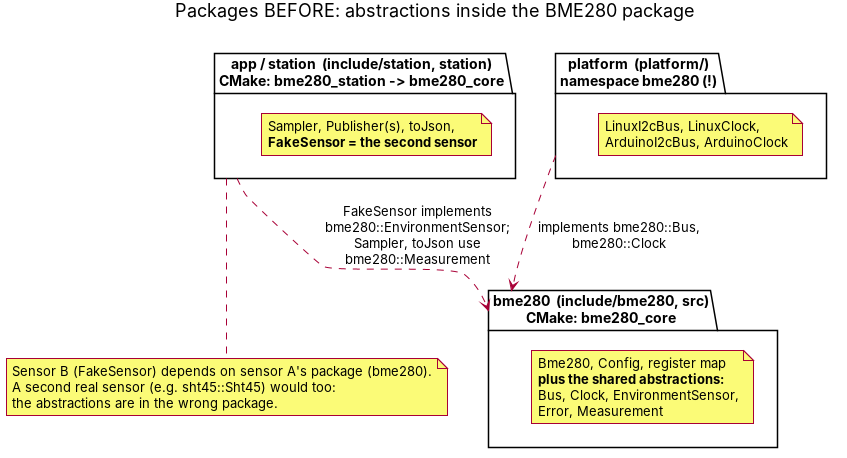
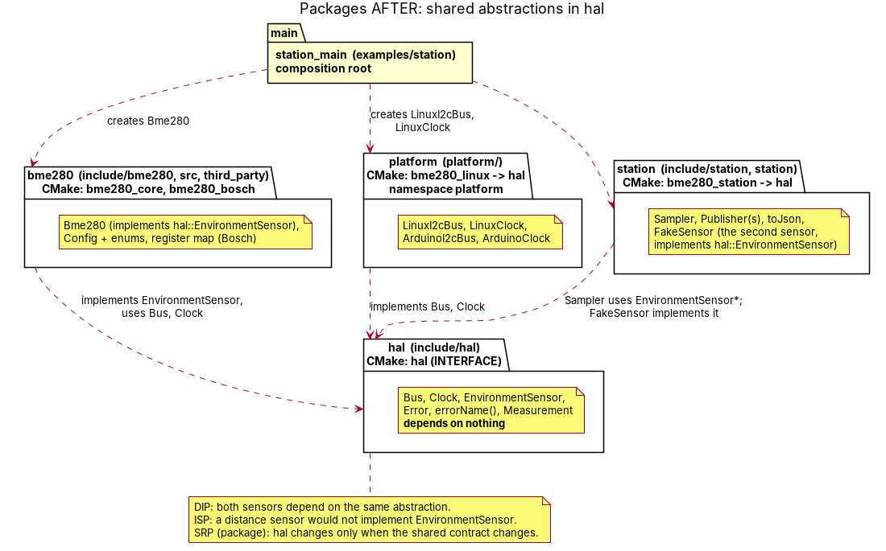

# Refactor report (assignment 8)

Review of the library and station **at the end of week 6** against DRY, KISS, SOLID, loose
coupling / strong cohesion and the lifecycle checklist of assignment 7/8, and what was changed.

**Reviewed state.** The week-6 hand-in, tag `v0.6-design` = commit `bda90c0` (branch `week6`).
The review was done before the tag was created, so every `file:line` below is given against the
commit, `bda90c0` (`git show v0.6-design:<file>` shows the same files).

## Findings

| # | What | Where (at `bda90c0`) | Principle | What changed | Commit |
|---|---|---|---|---|---|
| 1 | The abstractions every sensor shares (`Bus`, `Clock`, `EnvironmentSensor`, `Error`, `Measurement`) live in the BME280 package. The second sensor (`FakeSensor`), the `Sampler`, `toJson` and all four platform classes depend on `bme280::`, and the platform classes even sit in namespace `bme280`. | `include/bme280/Bus.hpp:13`, `include/bme280/Clock.hpp:12`, `include/bme280/EnvironmentSensor.hpp:15`, `include/bme280/Types.hpp:8` (`Error`), `:37` (`Measurement`); users: `include/station/FakeSensor.hpp:13`, `include/station/Sampler.hpp:35`, `include/station/Json.hpp:16`, `platform/linux/LinuxI2cBus.hpp:13`, `platform/linux/LinuxClock.hpp:7`, `platform/arduino/ArduinoI2cBus.hpp:12`, `platform/arduino/ArduinoClock.hpp:7` | DIP, SRP of a package, loose coupling | New package `hal` (see below). | `781481e` |
| 2 | Two copies of the same `switch` that turns an `Error` into text. | `examples/arduino/ReadEverySecond/ReadEverySecond.ino:12`, `examples/rpi/smoke_test.cpp:36` | DRY | One `errorName(Error)` next to the enum; it returns a string literal, so there is no `std::string` or allocation in the core. It is named `errorName` because `toString` collides (through ADL) with doctest's `toString` customisation point. | `d79ca9f` (moved into `hal` in `781481e`) |
| 3 | `Sampler::keepRunning()` is a second copy of `isRunning()`: both lock the mutex and return `running_`. Introduced in week 6. | `station/Sampler.cpp:59` (duplicate of `:53`) | DRY, KISS | Removed; `run()` uses `isRunning()`. | `2f4baa4` |
| 4 | `EnvironmentSensor` and `Publisher` have public copy assignment, so `*a = *b` through a base reference compiles and slices. `Bus` and `Clock` already protect their copy operations. | `include/bme280/EnvironmentSensor.hpp:15`, `include/station/Publisher.hpp:10` | Lifecycle checklist, LSP, consistency | Protected copy constructor and assignment, as in `Bus`/`Clock`. `static_assert`s in `test_core`/`test_station` keep them non-assignable. | `03d2875`, asserts in `781481e` |
| 5 | `test_core.cpp` has its own `FakeClock`; assignment 7 added the shared `tests/FakeClock.hpp`. | `tests/test_core.cpp:76` | DRY (tests) | `test_core` uses the shared `FakeClock`. | `4584ccc` |
| 6 | **Open, not changed.** `Bus::read()` always writes a register pointer, then reads with a repeated start. Command-based sensors (SHT31, SHT45: write a command, wait, then read with no pointer) cannot be driven through this `Bus`. | `include/bme280/Bus.hpp:17-23` (the `read` contract) | ISP | Nothing yet. Before a real second I2C sensor is added, `Bus` needs a plain read (or a second, command-oriented interface: ISP). Documented here so the next sensor does not hack around it. | - |

Not a finding in this code but worth recording: the week-2 starter's `MockBus` stores `data[i]` at
`reg + i`, while the Bosch driver writes several registers as `[value0, reg1, value1, …]`. The
week-7 `tests/MockBus.hpp` decodes those pairs (`d51b15e`).

## The mandatory refactor: the second sensor

**Before** (`bda90c0`): sensor B (`station::FakeSensor`) implements `bme280::EnvironmentSensor`,
so it depends on sensor A's package. A real `sht45::Sht45` would have had the same dependency:
the abstractions were in the wrong package.

**After** (`781481e`):

* **`hal`** (`include/hal/`, namespace `hal`, CMake `INTERFACE` target `hal`): `Bus`, `Clock`,
  `EnvironmentSensor`, `Error` (+ `errorName`), `Measurement`. It depends on nothing.
* **`bme280`** (`include/bme280/`, `src/`, `third_party/`; `bme280_core`, `bme280_bosch`):
  `Bme280` implements `hal::EnvironmentSensor`. It re-exports `hal::Error` and
  `hal::Measurement`, so users of the sensor can keep writing `bme280::Error`.
* **`platform`** (namespace `platform`; `bme280_linux` links only `hal`): implements `hal::Bus` and
  `hal::Clock`, with no BME280 dependency.
* **`station`** (`bme280_station` links only `hal` + Threads): `Sampler`, `FakeSensor` and `toJson`
  use `hal::` only.
* Only `station_main` (the composition root) and the examples name `Bme280`.

`bme280` and the second sensor both depend on `hal`, neither depends on the other, and `hal`
depends on nothing. `tests/check_dependencies.sh` (ctest `dependencies`) checks this on every test
run, and fails on a planted violation.

**What stays sensor-specific.**
* `Config`, `Oversampling`, `Filter`, `Standby`, `Mode` and `I2cAddress` are BME280-only, as is
  the register map (in the Bosch driver). They stay in `bme280`.
* **`Measurement` is shared.** `EnvironmentSensor`'s contract is "temperature, pressure and
  humidity", and the station publishes one JSON schema for every sensor. A sensor without
  pressure (SHT45) would force a decision: either it does not implement `EnvironmentSensor`
  (ISP), or `Measurement` gets optional fields. No such sensor exists in this project yet, so
  `Measurement` stays as it is.

**The second sensor.** No second physical sensor is available, so the second sensor is
`station::FakeSensor`, as the assignment allows. It implements `hal::EnvironmentSensor`; being a
fake, it uses no `Bus` (finding 6 explains what a real one would need). The station's
`std::vector<hal::EnvironmentSensor*>` holds `bme280::Bme280` and `station::FakeSensor`: two
classes from two packages.

**Did the `Sampler` and the publishers change?**
* `Publisher`, `ConsolePublisher`, `MqttPublisher`: **no**. The refactor commit does not touch
  them.
* `Sampler`, `FakeSensor`, `toJson`: only the names of the shared types (`bme280::` →
  `hal::`) and their include paths. The types themselves moved to another package; no logic or
  API shape changed.

**Principles applied.**
* **DIP:** both sensors and the `Sampler` depend on the same abstraction, `hal::EnvironmentSensor`.
* **ISP:** a distance sensor would not implement `EnvironmentSensor`. It would get its own small
  interface in `hal`.
* **SRP of a package:** `hal` changes only when the shared contract changes; `bme280` only when
  BME280 behaviour changes.

## Lifecycle checklist

| Rule | Status | Evidence |
|---|---|---|
| Every resource has an owner with a destructor | OK | `LinuxI2cBus` closes the fd (`~LinuxI2cBus`). `Sampler` joins its thread (`stop()`/`~Sampler`). `MqttPublisher` disconnects, stops the network loop and `mosquitto_destroy()`s the client. Valgrind with `--track-fds`: no leaks. |
| Resource owners are non-copyable; borrowers do not `delete` | OK | `LinuxI2cBus`, `Sampler`, `MqttPublisher`, `Bme280`: copy operations deleted (static_asserts in the tests). `Bme280` and `Sampler` hold references/pointers and never `delete` them. |
| Nothing in `core` calls `new`; no `std::string`/`<iostream>` in `core` | OK | `grep` on `include/hal`, `include/bme280`, `src/Bme280.cpp`: none. `errorName()` returns a string literal. |
| `const`-correct | OK | `measurementTimeUs() const`, `isInitialised() const`, `const Measurement&` in callbacks, `const Config&` parameters, `Sampler::isRunning() const`. |
| Construction does not touch hardware | OK | `Bme280(Bus&, Clock&)` only fills the Bosch struct; `init()` talks to the chip. Global objects in the Arduino sketches are built before `setup()`. (`LinuxI2cBus` does open the device in its constructor: that is the RAII the week-4 assignment asks for, and it is a platform class, not the sensor.) |
| Interfaces cannot slice | OK since `03d2875` | Protected copy operations on all four interfaces. |

## Embedded SOLID: what do the interfaces cost?

Measured on the SAMD21 (Cortex-M0+) build of `ReadEverySecond` (arm-none-eabi-gcc 13.2.1, `-Os`,
`-fno-rtti`, so there is no typeinfo; `arm-none-eabi-size` / `arm-none-eabi-nm -S`):

| Build | Flash (text) | data + bss | vtables in flash | vptrs in RAM |
|---|---|---|---|---|
| Week 3 (`v0.3-arduino`, one interface: `Bus`) | 27148 B | 4932 B | 28 B (`ArduinoI2cBus`) | 4 B |
| Week 7 (`Bus`, `Clock`, `EnvironmentSensor`) | 27292 B | 4944 B | 68 B (`Bme280` 24, `ArduinoI2cBus` 24, `ArduinoClock` 20) | 12 B (`bus`, `sensorClock`, `sensor`) |

The three interfaces cost **68 B of flash and 12 B of RAM**: 0.25 % of the image and 12 B of the
SAMD21's 32 KB RAM. `ArduinoClock` is 4 B large and all 4 B are its vtable pointer. Every call
through an interface adds an indirect call: a few cycles, nothing compared with an I2C transaction
or the 9.3 ms measurement wait. On a 2 KB AVR the same 12 B would still be acceptable. A clock as
a compile-time template parameter would save the bytes, but would cost the ability to pass a
`FakeClock` at run time. The interfaces stay.

The without-interfaces baseline above is the week-3 build (one interface), not a build with every
interface removed. Writing that variant would mean templating `Bme280` on its bus and clock, which
is a different design.
